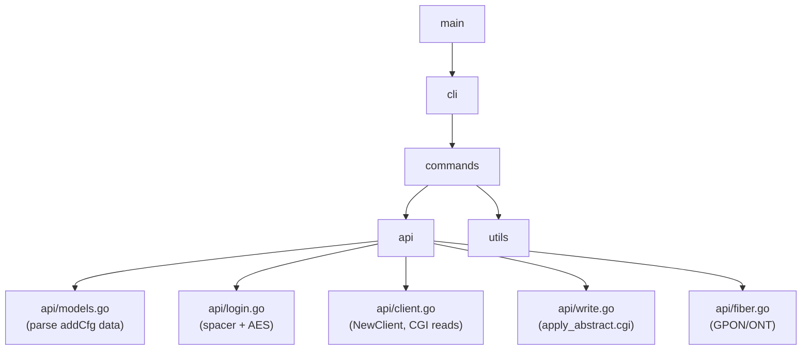
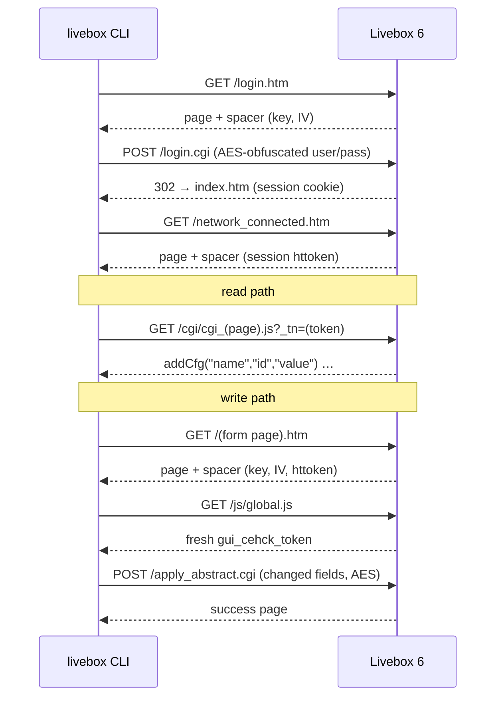

# Architecture

## Package layout

```
livebox-cli/
├── main.go              # thin entry point: calls cli.Run()
├── cli/                 # root command, global flags, signal context
├── commands/            # one file per command group (cobra)
├── api/                 # Livebox 6/7 client: login, cgi reads, apply writes
├── utils/               # table printing (lipgloss v2)
├── tools/               # offline HAR inspection helpers
└── testdata/livebox6/   # captured router fixtures (cgi/*.js, pages)
```



| Package | Purpose | Key exported types / functions |
|---|---|---|
| `cli` | Wires the root command, global flags (`--address`, `--username`, `--password`, `--debug`), SIGINT context; executes via `fang` | `Run()` |
| `commands` | Cobra command tree, one file per group; resolves config → `api.Client` | `*Command()` per group, `clientFromConfig` |
| `api` | Protocol client: login, CGI reads, apply writes, model parsing | `Client`, `Data`, `Device`, `PortForward`, `DMZ`, `DNSRecord`, `StaticLease`, `WLAN`, `Speed`, `FTTH`, `Pinhole` |
| `utils` | lipgloss v2 table rendering | `PrintTable` |
| `tools` | HAR decode utilities used during reverse engineering | — |

## Request flow

Every command follows the same three-step session: log in, do its work,
let the cookie jar carry the session.



## Layering rules

- `commands` never speaks HTTP — it only calls typed methods on
  `*api.Client` (`Devices`, `DMZSet`, `PinholeSet`, …) and renders results
  with `utils.PrintTable`.
- `api` hides the protocol: spacer crypto lives in `login.go`, the write
  form builder in `write.go` (`apply`/`applySubmit`), CGI parsing in
  `client.go`/`models.go`.
- Write commands mirror the web UI exactly: same action name, same form
  page, same fields — so the router sees nothing unusual. See
  [protocol.md](protocol.md) and [writes.md](writes.md).
- Stubs: commands whose payload is not yet captured return a clear error
  (`writeStub` in `commands/common.go`) and tolerate unknown flags so the
  command tree stays scriptable.

## Crypto primitives

All obfuscation uses the same primitive (AES-256-CBC, zero padding, `%xx`
output — `encode()` in `api/login.go`). The key material always comes from
the **spacer image** of the page being mimicked; the session token always
comes from the **logged-in page's** spacer. See
[protocol.md](protocol.md#the-spacer-image).
