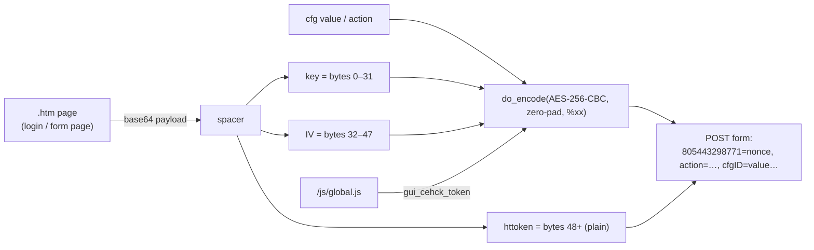
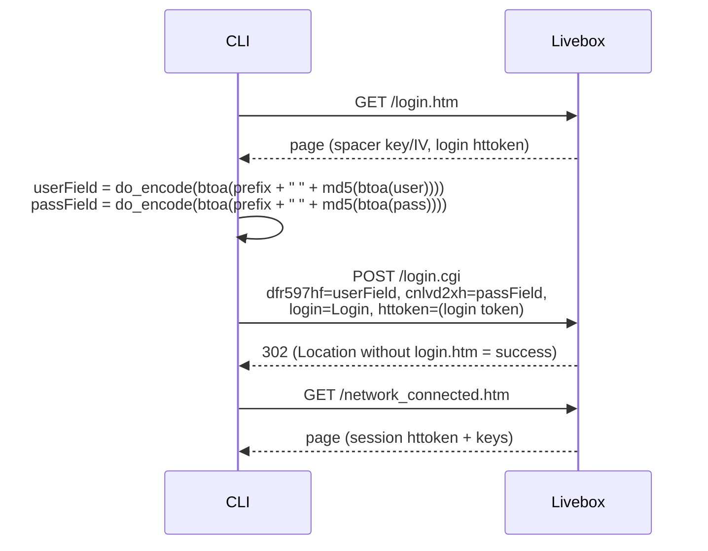
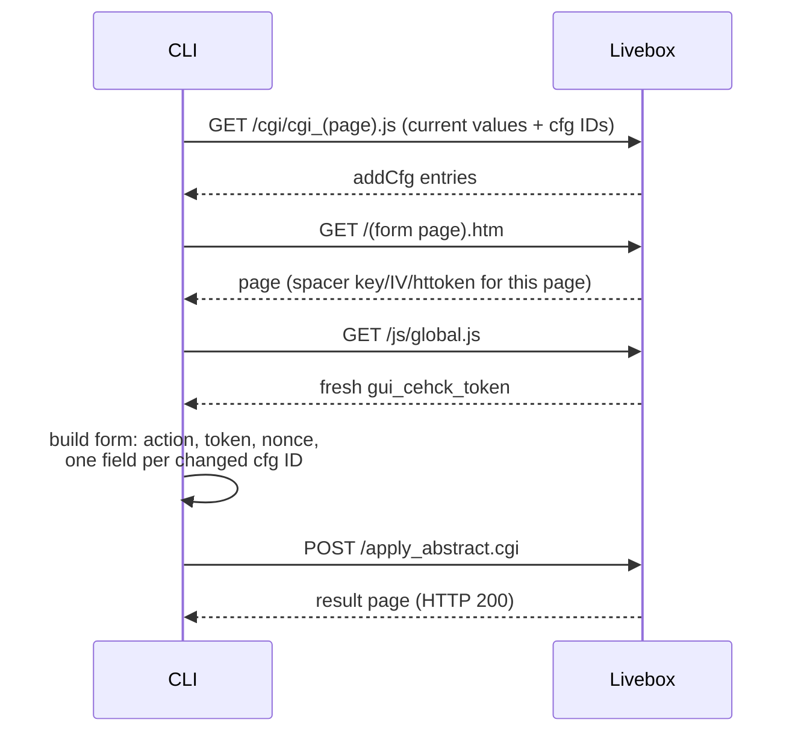

# Livebox 6/7 wire protocol

Notes on the reverse-engineered protocol this CLI speaks, as implemented in
`api/login.go`, `api/client.go` and `api/write.go`. Everything here was
recovered from the router's own JavaScript (`js/global.js`,
`js/subformvar.js`, `cgi/cgi_*.js`), live HAR captures, and in-browser
dry-run interception (write payloads captured, never sent).

## Why not `/ws`?

The Livebox 4/5 expose a JSON-RPC endpoint at `/ws` (documented by the
upstream [maelvls/livebox](https://github.com/maelvls/livebox) project).
The Livebox 6 (Arcadyan firmware) has no `/ws`: its web UI is a classic
frameset of `.htm` pages that fetch data from `cgi/cgi_<page>.js` files and
submit changes to `apply_abstract.cgi`, with every value AES-obfuscated.
This CLI reimplements that exact flow.

## The spacer image

Every relevant page embeds a 1×1 GIF as a `data:` URI whose base64 payload
carries the session crypto material:

```html
">
```

After the fixed GIF header (78 characters of the data URI, `spacerSkip` in
`login.go`), the decoded payload is laid out as:

| Bytes | Content | Used for |
|---|---|---|
| `[0:32]` | AES-256 key | `do_encode`/`do_decode` of form fields |
| `[32:48]` | AES CBC IV | same |
| `[48:]` | `httoken` (ASCII digits) | request token, plain in query strings and forms |

The token at `[48:]` is what the router's own `ArcBase._t(1)` returns; this
is pinned by a golden test against a captured `network_connected.htm`
(`testdata/livebox6/`). With the wrong token the router answers HTTP 404.



## do_encode / decode

`do_encode()` in the router's `js/global.js` (mirrored by `encode()` in
`api/login.go`):

1. Take the plaintext string.
2. Zero-pad it to a multiple of 16 bytes (no PKCS#7).
3. AES-256-CBC encrypt with the page's spacer key and IV.
4. Render each ciphertext byte as `%xx`.

The result is URL-safe as-is; the router's decoder strips `%` and decrypts.

## Login



- `prefix` is 32 random `[0-9a-z]` characters (`generatepassword()` in
  `login.htm`); the MD5 is of the base64 of the value.
- The two obfuscated fields are named `dfr597hf` (username) and `cnlvd2xh`
  (password).
- A failed login answers 302 back to `login.htm`; the CLI surfaces that as
  *"the Livebox rejected the username or password"*.
- The session is a cookie; the CLI uses a cookie jar and disables automatic
  redirects to detect the login outcome from the `Location` header.

## Reads — `cgi/*.js`

Data endpoints are plain JavaScript files returning `addCfg` calls:

```js
addCfg("wl_enable24G", "196637000000", "1");
addCfg("wl_ssid24G", "196635000000", "Livebox6-729B");
```

| Argument | Meaning |
|---|---|
| name | cfg key |
| id | **numeric cfg ID** — the form field name to write this key |
| value | current value (plaintext) |

Request shape (headers matter — the router rejects requests missing the
XHR marker or a valid `_tn` token):

```
GET /cgi/cgi_<page>.js?_tn=<session httoken>&_t=<ms>&_=<ms>
Referer: http://<router>/network_connected.htm
X-Requested-With: XMLHttpRequest
```

`api.Client.CGI(page)` parses the body into `Data` (entries + IDs + raw
text). Pages some commands use: `infoLan`/`clients` (devices), `nat_osp`
(port forwards), `fw_dmz_osp` (DMZ), `dns`, `lan_dhcp_static`,
`wlan_combine` (Wi-Fi), `infoInternet` (DSL sync), `infoFtth` (GPON
optics + ONT password), `firewall_customize` (pinhole rules), `upnp_osp`.

A few endpoints embed data outside `addCfg` — e.g. the DHCP lease table in
`cgi_infoLan.js` is a flat JavaScript array
(`var dhcp_leaseTime=['name','ip','mac','lease','iface', ...]`), parsed
directly from `Data.Raw`.

```mermaid
sequenceDiagram
    participant C as CLI
    participant L as Livebox

    C->>C: token = spacer[48:] of network_connected.htm
    C->>L: GET /cgi/cgi_nat_osp.js?_tn=(token)&_t=(ms)&_=(ms)<br/>X-Requested-With: XMLHttpRequest<br/>Referer: /network_connected.htm
    L-->>C: addCfg("nat_enable0","…","1"); …
    C->>C: parse into Data{entries, ids, Raw}<br/>→ typed models (PortForward, WLAN, …)
```

## Writes — `apply_abstract.cgi`

Every configuration change in the UI goes through the same dispatcher:
`subForm()` → `genForm()` builds a throwaway form → POST
`/apply_abstract.cgi`. The CLI replicates `genForm`'s semantics exactly.



### Form contents

| Field | Value | Encryption |
|---|---|---|
| `action` | action name (e.g. `ui_firewall`) | `do_encode` |
| `httoken` | spacer token of the **form page** | plain |
| `submit_button` | page to return to (usually the form page; `index.htm` for reboot) | plain |
| `action_params` | only when non-empty (e.g. `RebootFromGUI`, `br0`) | `do_encode` |
| `805443298771` | the `gui_cehck_token` (anti-replay nonce, fetched fresh per write) | `do_encode` |
| `<cfg ID>` | new value of one **changed** cfg key | `do_encode`, or plain when clearing |

Key rules, verified against `genForm()` in `js/global.js` and live captures:

1. **Only changed fields are posted** — `genForm` iterates the cfg table and
   emits a field only when `CA[i].v != CA[i].o`. The CLI therefore fetches
   the current values first and posts just the fields it modifies, keyed by
   their numeric cfg ID from `addCfg`.
2. **The key/IV/token come from the form page**, not the login page — each
   `.htm` has its own spacer, so the CLI re-fetches the page before every
   write.
3. **The nonce is server-issued.** The router injects a fresh
   `gui_cehck_token` into `/js/global.js` on every load; `addCfg` line 2 is
   its value, and `805443298771` is the form field carrying it. The name
   `805443298771` is itself the addCfg *ID* of that key.
4. **Empty (cleared) fields are posted plain** (`ID=` with no value) — that
   is how the UI deletes entries, and how the CLI implements `rm`.
5. The response is an HTML page; HTTP 200 means accepted. Invalid or
   replayed tokens get 404/error pages, which the CLI reports.

### Per-command recipes (summary)

| Command | Form page | `action` | `action_params` | Fields written |
|---|---|---|---|---|
| `static-lease set/rm` | `advanced_network_configuration.htm` | `ui_dhcp_static` | `br0` | `static_{active,name,mac,ip}_0_<slot>` + `static_enable` |
| `port-forward set/rm` | `advanced_network_nat.htm` | `ui_pcp_nat` | — | 15 `pcp_rule_*`/`nat_*` fields of the slot |
| `dns set/rm` | `advanced_network_dns.htm` | `ui_dns` | — | `dns_hostname<slot>`, `dns_ip<slot>` |
| `dmz set/rm` | `advanced_network_dmz.htm` | `ui_firewall` | — | `dmz_enable`, `host_ip` (rm: only `host_ip=""`) |
| `wifi enable/disable` | `advanced_wifi.htm` | `ui_wireless` | — | `wl_enable24G`, `wl_enable5G`, `wl_enable_change=1` |
| `pinhole set/rm` | `advanced_firewall_customize.htm` | `ui_firewall_all` | — | ten `firewall_rules_*<slot>` fields |
| `reboot` | `support_restart.htm` | `reboot` | `RebootFromGUI` | none; `submit_button=index.htm` |

Full details, field-ID tables and decrypted captures:
[writes.md](writes.md).

## Session quirks

- **One session at a time.** A new web login evicts the previous session
  (browser ⇄ CLI). Expect reads to fail with 404/redirect right after
  someone opens the UI — the CLI re-logs in on the next invocation.
- **Tokens are per-page and rotate.** Never reuse a captured `_tn` or
  `gui_cehck_token` across commands; always fetch fresh, as `apply()` does.
- **`_t`/`_` are cache-busters** (millisecond timestamps), not security
  parameters.
